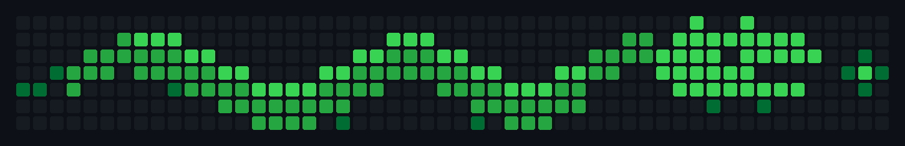
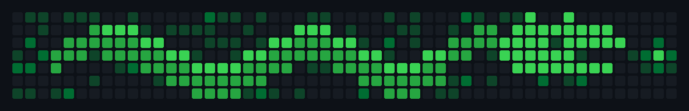

# commitzilla 🦖

A Japanese dragon, painted one day at a time onto a contribution graph.



Every day from **2026-10-18** to **2027-10-16** is one pixel. The shade of each
pixel is how many contributions land on that date, so drawing the dragon means
making exactly the right amount of noise on exactly the right days — and staying
completely silent on the days that have to remain dark.

The tail is painted first. The head lands in the final weeks.

### What it will really look like



Felipe's own work lit 111 of the last 365 days, almost always at 1-5
contributions. Those land wherever they land, including on squares the dragon
needs dark, and contributions can never be removed. So the dragon deliberately
uses **no level 1 at all** — the art lives at levels 2-4 and the background noise
stays visibly dimmer than every part of the picture. Regenerate this preview at
the historical rate with `python3 scripts/preview_noise.py [seed]`.

## The other dragon

The same picture is being uncovered in [`DRAGON.md`](DRAGON.md), one sliver per
commit, wiping left to right in lockstep with the squares. Neither is "junk
commits": every commit in the nightly batch carries a real diff, because it
advances the reveal. Both finish on the same day.

## How it runs

| | |
|---|---|
| **Painter** | `.github/workflows/commitzilla.yml` — nightly cron. Makes the commits, opens one PR, merges it, deletes the branch. Dumb and reliable. |
| **Supervisor** | a nightly Claude routine following [`AGENT_BRIEF.md`](AGENT_BRIEF.md). Reads the real graph back, repairs pale squares, retunes the shading, keeps the journal. |

One PR per painted night, merged with `--merge` and `--delete-branch`, so the
repo never holds more than a single branch.

## Why it needs a supervisor at all

GitHub's five shades are **relative to the busiest day of your trailing year**, not
fixed counts. Real work moves that maximum, which silently demotes squares that
were already painted. So the system does not fire and forget: it reads the actual
colour of every square back out of the GraphQL API, learns the live thresholds
from the colours themselves, and tops up anything that came out pale using
backdated commits. Contributions can never be removed, which is why every target
aims at the *bottom* of its band and leaves headroom.

## Files

```
config.json          shading, identity, dates
art/dragon.grid      7x52 of levels 0-4 — the target image, hand-tunable
art/dragon_ascii.txt the big ASCII version DRAGON.md reveals
plan/schedule.json   frozen date -> level -> commit count
state/               progress, journal, achievements, last observed grid
out/                 target.png, actual.png, and SVGs for this page
scripts/             build_*, paint, verify, render, ascii_reveal, achievements
```

## Checking on it

```bash
python3 scripts/render.py --target            # the whole dragon, today
python3 scripts/verify.py --days 30           # target vs. what GitHub shows
python3 scripts/paint.py --date 2027-03-14 --dry-run
python3 scripts/paint.py --simulate-year      # replay all 364 days
python3 scripts/achievements.py --status
```

## Achievements

Tracked in [`state/achievements.md`](state/achievements.md). Pull Shark, YOLO and
Quickdraw are pursued automatically. Pair Extraordinaire, Starstruck, Galaxy Brain
and Public Sponsor are recorded but not automated, because each one needs either
another real person or a spending decision — the reasons are written down there
rather than quietly skipped.

## Honest note

These commits are decorative. They are not work, and a graph painted this way
stops being a signal of real activity. That was the point of the exercise.
